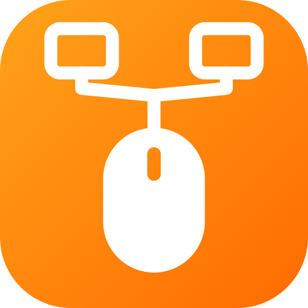
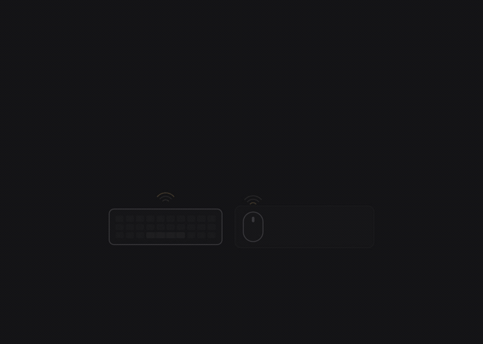

<div align="center">
  
  <h1>Mause</h1>
  <p>One keyboard and mouse for every computer on your desk.</p>
  <p>
    <a href="https://github.com/Sanalarge/mause/actions/workflows/ci.yml"></a>
    <a href="https://github.com/Sanalarge/mause/releases"></a>
    <a href="LICENSE"></a>
  </p>
  <p><strong>English</strong> · <a href="README.tr.md">Türkçe</a></p>
</div>



Mause is an open-source software KVM for controlling computers and Android devices on the same network with one keyboard and mouse. Move the pointer across a screen edge to switch devices and keep working without changing hardware.

> [!IMPORTANT]
> Mause is in early development. Review permissions and test it in a trusted local network before relying on it in production.

## Features

| Capability | Description |
| --- | --- |
| Seamless input | Share keyboard and mouse across Windows, macOS, Linux and Android devices. |
| Screen layout | Arrange devices spatially and switch by moving through a screen edge. |
| Per-computer preferences | Recognize connected PCs by identity and automatically restore their saved layout and sharing settings. PCs sharing a saved position are placed next to each other when connected together. |
| Secure pairing | Confirm a matching code on both devices before a connection is trusted. |
| Encrypted transport | Protect paired-device traffic with end-to-end encryption. |
| Clipboard and files | Move text and files between paired computers. |
| Media sharing | Share audio, microphone and screens when supported by the platform. |
| Native packaging | Install desktop builds with Windows Setup, a macOS app bundle or Linux packages; build Android from source. |
| System theme | Follow the operating system's light or dark appearance. |

## Install

Download the newest package from [GitHub Releases](https://github.com/Sanalarge/mause/releases).

### Windows

Download `mause-vX.Y.Z-windows-x86_64-setup.exe` and run it as an administrator. Setup verifies and installs the required Visual C++ runtime and selected USB support components offline. A driver installation may require a restart.

### macOS

Download `mause-vX.Y.Z-macos-universal.zip`, extract it and move `Mause.app` to Applications. Grant Accessibility permission for keyboard and mouse control. Screen Recording and microphone permissions are only needed for the related sharing features.

### Linux

- Debian, Ubuntu, Mint or Pop!_OS: `sudo apt install ./mause-vX.Y.Z-linux-x86_64.deb`
- Fedora, openSUSE or RHEL: `sudo dnf install ./mause-vX.Y.Z-linux-x86_64.rpm`
- Other distributions: extract the `.tar.gz` archive and run `sudo ./mause/install.sh`

The release build targets glibc 2.35 or newer and uses PipeWire. The first run may request permission to configure input access; sign out and back in after granting it.

### Android

Mause does not currently publish a prebuilt Android APK. Build the Android application from source with the instructions below, install the generated debug APK, then enable the Mause accessibility service and input permissions. Android acts as a device controlled by the primary computer; it does not mirror the Android screen to the computer.

## Pair devices

1. Install and open Mause on both devices.
2. Keep both devices on the same trusted local network.
3. Select the discovered device or enter its IP address.
4. Confirm that the pairing code is identical on both screens.
5. Place the device in the screen layout and move the pointer across the configured edge.

## Build from source

The desktop application requires Rust 1.99.1. Platform packages may require the native development libraries used by input, audio and PipeWire integrations.

```console
git clone https://github.com/Sanalarge/mause.git
cd mause
cargo build --release --locked
```

Build the Windows installer from PowerShell:

```powershell
pwsh ./packaging/windows/Build-Installer.ps1
```

Build Android with Java 17, Android SDK, Android NDK, the four Rust Android targets and `cargo-ndk`:

```console
cd mobile/android/rust
cargo ndk -t arm64-v8a -t armeabi-v7a -t x86_64 -t x86 -o ../app/src/main/jniLibs build --release --locked
cd ..
./gradlew assembleDebug
```

## Releases

Pull requests run formatting, desktop tests, platform checks, the Windows installer lifecycle test and an Android source build. A push does not publish a release. Maintainers start the `Release` workflow manually; it creates a `vX.Y.Z` tag and publishes Windows, macOS and Linux artifacts. Android remains source-only and is not attached to releases.

Apple Developer ID and notarization secrets are optional; without them the macOS bundle uses an ad-hoc signature.

## Contributing

Mause uses a small trunk-based workflow: `main` is the only permanent branch. External contributions are accepted through pull requests. Create a short-lived `feature/*`, `fix/*`, `docs/*` or `chore/*` branch and open a pull request. CI starts after the current revision is approved by the project owner account, `Sanalarge`; approved changes are squash-merged after CI succeeds. See [CONTRIBUTING.md](CONTRIBUTING.md).

Security vulnerabilities should not be filed as public issues. Follow [SECURITY.md](SECURITY.md) instead.

## Attribution and license

Mause is licensed under the [Apache License 2.0](LICENSE). If you redistribute Mause or a derivative, you must preserve the license, copyright notices and the attribution in [NOTICE](NOTICE), as required by that license. Clearly credit the original Mause developers; do not imply that they endorse your derivative.

Third-party components retain their own licenses. See [THIRD_PARTY_NOTICES.md](THIRD_PARTY_NOTICES.md) and the license files distributed with the relevant assets.

## Developers

| Developer | GitHub | LinkedIn |
| --- | --- | --- |
| Muhammed Taymur | [@ByTaymur](https://github.com/ByTaymur) | [Profile](https://www.linkedin.com/in/muhammed-t-aaa770281/) |
| Serdar Kayışkıran | [@serdarkayiskiran](https://github.com/serdarkayiskiran) | [Profile](https://www.linkedin.com/in/serdarkayiskiran/) |

