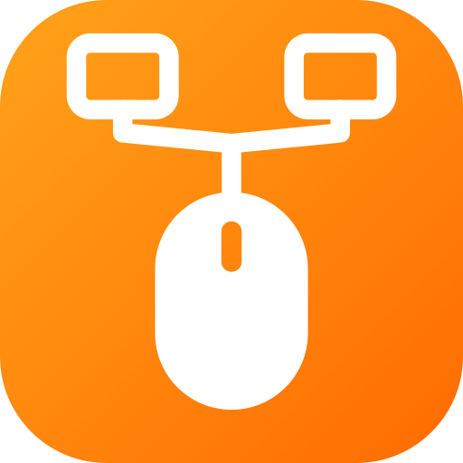
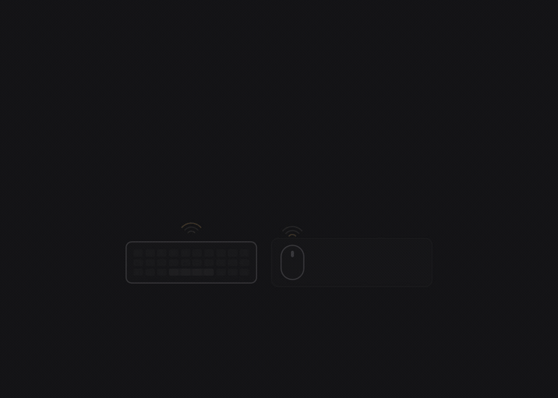

<div align="center">
  
  <h1>Mause</h1>
  <p>Masanızdaki tüm bilgisayarlar için tek klavye ve fare.</p>
  <p>
    <a href="https://github.com/Sanalarge/mause/actions/workflows/ci.yml"></a>
    <a href="https://github.com/Sanalarge/mause/releases"></a>
    <a href="LICENSE"></a>
  </p>
  <p><a href="README.md">English</a> · <strong>Türkçe</strong></p>
</div>



Mause; aynı ağdaki bilgisayarları ve Android cihazları tek klavye ve fareyle yönetmeyi sağlayan açık kaynaklı bir yazılım KVM uygulamasıdır. İmleci ekran kenarından geçirerek cihaz değiştirir, donanım değiştirmeden çalışmaya devam edersiniz.

> [!IMPORTANT]
> Mause erken geliştirme aşamasındadır. İzinleri inceleyin ve üretimde kullanmadan önce güvenilir bir yerel ağda deneyin.

## Özellikler

| Özellik | Açıklama |
| --- | --- |
| Kesintisiz giriş | Klavye ve fareyi Windows, macOS, Linux ve Android cihazlarla paylaşır. |
| Ekran yerleşimi | Cihazları konumlandırır, imleci ekran kenarından geçirerek geçiş yapar. |
| Bilgisayara özel ayarlar | Bağlanan PC'yi kimliğinden tanır; kayıtlı yerleşimini ve paylaşım ayarlarını otomatik geri yükler. Aynı konumdaki PC'ler birlikte bağlanınca yan yana yerleştirilir. |
| Güvenli eşleştirme | Bağlantıya güvenmeden önce iki cihazda aynı kodu onaylatır. |
| Şifreli taşıma | Eşleşmiş cihaz trafiğini uçtan uca şifreler. |
| Pano ve dosyalar | Metni, panodaki görselleri ve dosyaları eşleşmiş bilgisayarlar arasında taşır. |
| Medya paylaşımı | Platform desteklediğinde ses, mikrofon ve ekran paylaşır. |
| Ek monitör | Bir bilgisayarın masaüstünü başka bir bilgisayara ya da Android tablete genişletir. Windows isteğe bağlı sanal ekran sürücüsünü kullanır; macOS ve Linux Wayland ekranı kendisi oluşturur. |
| USB paylaşımı | Başka bir bilgisayara takılı USB aygıtlarını kendi bilgisayarınızdan kullanmanızı sağlar. |
| Kenar geçişi | İmleç kenara değdiği an geçer; isterseniz kenarda bekleyerek geçmeyi açabilirsiniz. Geçilen bilgisayar adını ve işletim sistemini gösterir. |
| Cihaz durumu | İsteğe bağlı olarak bağlı cihazların işlemci, bellek, GPU, disk ve ağ kullanımını gösterir. |
| Otomatik güncelleme | Masaüstü sürümleri açılışta GitHub Releases'ı denetler ve en yeni sürümü kurar. |
| Yerel paketler | Masaüstünde Windows Setup, macOS uygulaması veya Linux paketi kullanılır; Android kaynaktan derlenir. |
| Sistem teması | İşletim sisteminin açık veya koyu görünümünü izler. |

## Kurulum

En güncel paketi [GitHub Releases](https://github.com/Sanalarge/mause/releases) sayfasından indirin.

### Windows

`mause-vX.Y.Z-windows-x86_64-setup.exe` dosyasını indirin ve yönetici olarak çalıştırın. Kurulum gerekli Visual C++ çalışma zamanını ve seçilen USB destek bileşenlerini doğrulayarak çevrimdışı kurar. Sürücü kurulumu yeniden başlatma isteyebilir.

### macOS

`mause-vX.Y.Z-macos-universal.zip` dosyasını açıp `Mause.app` uygulamasını Uygulamalar klasörüne taşıyın. Klavye ve fare denetimi için Erişilebilirlik izni verin. Ekran Kaydı ve mikrofon izinleri yalnızca ilgili paylaşım özellikleri için gerekir.

### Linux

- Debian, Ubuntu, Mint veya Pop!_OS: `sudo apt install ./mause-vX.Y.Z-linux-x86_64.deb`
- Fedora, openSUSE veya RHEL: `sudo dnf install ./mause-vX.Y.Z-linux-x86_64.rpm`
- Diğer dağıtımlar: `.tar.gz` arşivini açıp `sudo ./mause/install.sh` çalıştırın.

Release paketi glibc 2.35 veya üstünü hedefler ve PipeWire kullanır. İlk açılış giriş iznini yapılandırmak için parola isteyebilir; izni verdikten sonra oturumu kapatıp yeniden açın.

### Android

Mause şimdilik hazır Android APK'sı yayımlamaz. Android uygulamasını aşağıdaki adımlarla kaynak koddan derleyin, oluşan debug APK'yı kurun ve Mause erişilebilirlik hizmetiyle giriş izinlerini etkinleştirin. Android, ana bilgisayarın klavye ve faresiyle yönetilir. İzin verdiğinizde ekranını, dosyalarını, sesini ve kameralarını bilgisayarla paylaşabilir ve bilgisayar için ek monitör olarak kullanılabilir.

## Cihazları eşleştirme

1. Mause'u iki cihazda da kurup açın.
2. İki cihazı aynı güvenilir yerel ağa bağlayın.
3. Görünen cihazı seçin veya IP adresini yazın.
4. Eşleştirme kodunun iki ekranda aynı olduğunu doğrulayın.
5. Cihazı ekran yerleşimine koyun ve imleci ayarlanan kenardan geçirin.

Ekran görüntüsünü paylaşmak için sistem panosuna kopyalayın, imleci eşleşmiş bilgisayara geçirin ve görselleri destekleyen bir uygulamaya yapıştırın. Görsel paylaşımı metinle aynı pano ayarını kullanır ve iki cihazda da güncel Mause gerektirir. Masaüstünde görseli **Ayarlar → Pano ile paylaşım** bölümünde görebilirsiniz. Linux'ta panodaki görseller Wayland üzerinden aktarılır.

Android'de gelen görseli görmek veya eşleşmiş bilgisayara görsel göndermek için **Pano** kartını açın. Panoya kopyalanmış bir görsel için **Panodaki görseli gönder**, telefona kaydedilmiş bir ekran görüntüsü için **Ekran görüntüsü seç ve gönder** düğmesini kullanın.

## Kaynaktan derleme

Masaüstü uygulaması Rust 1.99.1 gerektirir. Platform paketleri; giriş, ses ve PipeWire bütünleşmelerinin kullandığı yerel geliştirme kitaplıklarını gerektirebilir.

```console
git clone https://github.com/Sanalarge/mause.git
cd mause
cargo build --release --locked
```

Windows kurulum paketini PowerShell ile oluşturun:

```powershell
pwsh ./packaging/windows/Build-Installer.ps1
```

Android derlemesi için Java 17, Android SDK, Android NDK, dört Rust Android hedefi ve `cargo-ndk` gerekir:

```console
cd mobile/android/rust
cargo ndk -t arm64-v8a -t armeabi-v7a -t x86_64 -t x86 -o ../app/src/main/jniLibs build --release --locked
cd ..
./gradlew assembleDebug
```

## Release süreci

Pull request açıldığında biçimlendirme, masaüstü testleri, platform kontrolleri, Windows kurulum yaşam döngüsü testi ve Android kaynak derlemesi çalışır. Push işlemi release yayımlamaz. Bakımcı `Release` akışını elle başlatır; akış `vX.Y.Z` etiketi oluşturup Windows, macOS ve Linux çıktılarını yayımlar. Android kaynak olarak sunulur ve release'e APK eklenmez.

Apple Developer ID ve noter secrets değerleri isteğe bağlıdır; yoksa macOS paketi geçici imzayla hazırlanır.

## Katkıda bulunma

Mause sade bir trunk-based akış kullanır: kalıcı tek dal `main` dalıdır. Dışarıdan katkılar yalnızca pull request ile kabul edilir. Kısa ömürlü bir `feature/*`, `fix/*`, `docs/*` veya `chore/*` dalı açıp pull request oluşturun. Güncel değişiklik proje sahibi `Sanalarge` hesabı tarafından onaylandığında CI başlar; CI başarılı olduktan sonra squash merge yapılır. Ayrıntılar için [CONTRIBUTING.md](CONTRIBUTING.md) dosyasına bakın.

Güvenlik açıklarını herkese açık issue olarak bildirmeyin. [SECURITY.md](SECURITY.md) içindeki yolu kullanın.

## Atıf ve lisans

Mause, [Apache License 2.0](LICENSE) ile lisanslanır. Mause'u veya türetilmiş bir çalışmayı dağıtıyorsanız lisansın gerektirdiği biçimde lisansı, telif bildirimlerini ve [NOTICE](NOTICE) içindeki atfı korumalısınız. Özgün Mause geliştiricilerini açıkça referans gösterin; geliştiricilerin türetilmiş çalışmanızı desteklediği izlenimini vermeyin.

Üçüncü taraf bileşenler kendi lisanslarını korur. [THIRD_PARTY_NOTICES.md](THIRD_PARTY_NOTICES.md) ve ilgili varlıklarla dağıtılan lisans dosyalarına bakın.

## Geliştiriciler

| Geliştirici | GitHub | LinkedIn |
| --- | --- | --- |
| Muhammed Taymur | [@ByTaymur](https://github.com/ByTaymur) | [Profil](https://www.linkedin.com/in/muhammed-t-aaa770281/) |
| Serdar Kayışkıran | [@serdarkayiskiran](https://github.com/serdarkayiskiran) | [Profil](https://www.linkedin.com/in/serdarkayiskiran/) |

